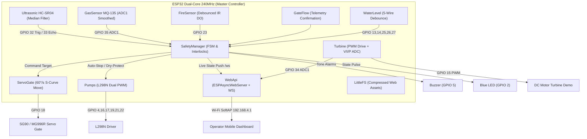

<<<<<<< HEAD
# AquaGuard Dam Control — Autonomous Miniature Dam & Hydro-Power SCADA

[](https://platformio.org/)
[](https://www.arduino.cc/)
[](data/index.html)
[](src/WebApi.cpp)
[](#compilation--flashing)

> **AquaGuard** is an industrial-grade embedded automation and telemetry system built for a **2 ft × 2 ft physical miniature dam prototype**. Powered by a single **ESP32 microcontroller (240 MHz Dual-Core)**, it orchestrates a servo spillway gate (SG90 / MG996R), dual L298N submersed pumps, 5-wire conductivity reservoir monitoring, an HC-SR04 ultrasonic proximity safety interlock, an MQ-135 hazardous gas analyzer, infrared flame detection, and a **Hydro-Electric DC Turbine Generator Demo** featuring live Voltage, Current, Power, and RPM telemetry.
>
> The system serves a standalone, military-grade **SCADA mobile web dashboard** directly from its internal LittleFS flash storage via its own high-speed Wi-Fi Access Point (`AquaGuard-Dam`).

---

## Table of Contents
1. [System Architecture](#system-architecture)
2. [Complete Hardware Pin Definition Table](#complete-hardware-pin-definition-table)
3. [Electrical Schematics & Wiring Guides](#electrical-schematics--wiring-guides)
4. [Sensor & Actuator Deep Dive](#sensor--actuator-deep-dive)
   - [Spillway Servo Gate (SG90 / MG996R)](#1-spillway-servo-gate-sg90--mg996r)
   - [5-Wire Reservoir Level & Flow Sensing](#2-5-wire-reservoir-level--flow-sensing)
   - [HC-SR04 Proximity Safety Interlock & Auto-Warning](#3-hc-sr04-proximity-safety-interlock--auto-warning)
   - [MQ-135 Gas & Air Quality Sensor](#4-mq-135-gas--air-quality-sensor)
   - [Infrared Flame / Fire Sensor](#5-infrared-flame--fire-sensor)
   - [Dual L298N Water Pumps](#6-dual-l298n-water-pumps)
   - [Hydro-Electric DC Turbine Generator Demo](#7-hydro-electric-dc-turbine-generator-demo)
   - [Active Buzzer & LED Status Signaling](#8-active-buzzer--led-status-signaling)
5. [Sensor Disconnection & Auto-Warning Safety Logic](#sensor-disconnection--auto-warning-safety-logic)
6. [SCADA Web Dashboard (Stitch Architecture)](#scada-web-dashboard-stitch-architecture)
7. [REST API & WebSocket Protocol](#rest-api--websocket-protocol)
8. [Compilation & Flashing](#compilation--flashing)
9. [Development Mock Server](#development-mock-server)

---

## System Architecture



---

## Complete Hardware Pin Definition Table

Every single pin on the ESP32 is mapped in [include/pins.h](include/pins.h). **No pins conflict with ESP32 flash memory (GPIO 6–11) or Wi-Fi ADC2 restrictions.**

| ESP32 GPIO | Direction | Signal Type | Component / Module | Wire Color | Electrical Requirement / Resistor Divider | Notes & Hardware Rules |
| :--- | :--- | :--- | :--- | :--- | :--- | :--- |
| **GPIO 2** | OUTPUT | Digital Out | Onboard / Blue Status LED | PCB Blue | Direct (Internal current limiting resistor) | Solid ON = SAFE; 750ms blink = WARNING; 250ms blink = CRITICAL. (Strapping pin: pulled LOW on boot). |
| **GPIO 4** | OUTPUT | PWM (LEDC Ch 0) | Pump 1 Enable (L298N ENA) | White | Direct to L298N ENA jumper pin | 1 kHz, 8-bit resolution (0–255 duty cycle). Controls flow speed of inlet pump. |
| **GPIO 5** | OUTPUT | PWM (LEDC Ch 2) | Active/Passive Buzzer | Purple | Direct / 100Ω current limiting resistor | LEDC tone generator: 500 Hz slow beep for WARNING; 1000 Hz fast beep for CRITICAL. |
| **GPIO 13** | INPUT | Digital In | Gate Flow Confirmation Wire | Blue | Internal `INPUT_PULLUP` (GND bridge) | Positioned in discharge tailrace directly below gate. Wet when gate discharges water. |
| **GPIO 14** | INPUT | Digital In | Reservoir DAM WARNING Wire | Red | Internal `INPUT_PULLUP` (GND bridge) | Positioned at 95% crest height. When wet: triggers flood alarm, opens gate to 100°, halts inlet pumps. |
| **GPIO 15** | OUTPUT | PWM (LEDC Ch 3) | **Turbine Demo Motor Drive** | Orange | Gate of 2N2222 / N-Channel MOSFET or L298N IN | 1 kHz PWM speed control for DC motor turbine demonstration. Remote dashboard ON/OFF. |
| **GPIO 16** | OUTPUT | Digital Out | Pump 1 Direction IN1 | Gray | Direct to L298N IN1 | Forward direction control for Pump 1. |
| **GPIO 17** | OUTPUT | Digital Out | Pump 1 Direction IN2 | Brown | Direct to L298N IN2 | Inverted direction control for Pump 1. |
| **GPIO 18** | OUTPUT | PWM (50 Hz Servo) | Spillway Gate Servo (SG90/MG996R) | Yellow/Orange | Direct to Servo Signal wire | Pulse range: 500 µs (0°) to 2400 µs (100°). Auto-detaches after 2s idle to protect servo gears. |
| **GPIO 19** | OUTPUT | Digital Out | Pump 2 Direction IN3 | Green | Direct to L298N IN3 | Forward direction control for Pump 2. |
| **GPIO 21** | OUTPUT | Digital Out | Pump 2 Direction IN4 | Yellow | Direct to L298N IN4 | Inverted direction control for Pump 2. |
| **GPIO 22** | OUTPUT | PWM (LEDC Ch 1) | Pump 2 Enable (L298N ENB) | Blue | Direct to L298N ENB jumper pin | 1 kHz, 8-bit resolution (0–255 duty cycle). Controls flow speed of outlet/aux pump. |
| **GPIO 23** | INPUT | Digital In | IR Flame / Fire Sensor (DO) | Yellow | Direct to Flame Module DO pin | Active LOW when flame detected. Built-in software 3-sample debounce filter. |
| **GPIO 25** | INPUT | Digital In | Reservoir LOW Wire (25%) | Green | Internal `INPUT_PULLUP` (GND bridge) | Lowest probe. When dry while pumps run >60s, flags dry-run warning. |
| **GPIO 26** | INPUT | Digital In | Reservoir MEDIUM Wire (50%) | Yellow | Internal `INPUT_PULLUP` (GND bridge) | Nominal operating reservoir elevation wire. |
| **GPIO 27** | INPUT | Digital In | Reservoir HIGH Wire (75%) | Orange | Internal `INPUT_PULLUP` (GND bridge) | Automatic threshold: opens gate to 50° to prevent reservoir crest overflow. |
| **GPIO 32** | OUTPUT | Digital Out | HC-SR04 Ultrasonic TRIG | Green | Direct to HC-SR04 TRIG pin | 10 µs trigger pulse every 60 ms. |
| **GPIO 33** | INPUT | Digital In | HC-SR04 Ultrasonic ECHO | White | **1 kΩ / 2 kΩ Voltage Divider (5V → 3.3V)** | **CRITICAL:** Echo is 5V. Must use divider (Echo → 1kΩ → GPIO 33 → 2kΩ → GND) to prevent damage. |
| **GPIO 34** | INPUT | Analog (ADC1_CH6) | **Turbine Voltage / Current Sense** | Blue | **10 kΩ / 3.3 kΩ Voltage Divider (0–12V → 3.3V)** | **ADC1 ONLY:** ADC2 cannot be used during Wi-Fi. Computes Live Volts, Current, Power, and RPM. |
| **GPIO 35** | INPUT | Analog (ADC1_CH7) | MQ-135 Gas Sensor (AO) | Violet | **1 kΩ / 2 kΩ Voltage Divider (5V → 3.3V)** | **ADC1 ONLY:** Raw 0–4095 ADC. 60s warm-up timer. Warning at 1500 raw; Danger at 2800 raw. |
| **GND** | COMMON | Common Ground | All Sensors, Drivers & Common Wire | Black | Solid copper bus / Breadboard common rail | **Common Ground wire** extends to the bottom of the water reservoir as the reference cathode. |
| **5V / VIN** | POWER | Power Supply Rail | L298N 5V Out / 5V 2A Regulated Rail | Red | External 5V 2A–3A power adapter | Powers SG90 servo, HC-SR04, MQ-135 heater, and L298N logic. **Do not power servos from ESP32 3.3V!** |

---

## Electrical Schematics & Wiring Guides

### 1. Voltage Divider Circuits

#### A. HC-SR04 Echo Pin (5V → 3.3V Protection)
```
HC-SR04 ECHO (5V) ────[ 1 kΩ ]────┬──── ESP32 GPIO 33
                                  │
                                [ 2 kΩ ]
                                  │
                                 GND
```
$$\text{Calculated } V_{\text{out}} = 5.0\,\text{V} \times \frac{2000}{1000 + 2000} = 3.33\,\text{V}$$

#### B. MQ-135 Analog Output (5V → 3.3V Protection)
```
MQ-135 AOUT (5V) ────[ 1 kΩ ]────┬──── ESP32 GPIO 35 (ADC1_CH7)
                                 │
                               [ 2 kΩ ]
                                 │
                                GND
```

#### C. DC Motor Turbine Voltage Sensing (0–12V Generator → 3.3V Range)
```
Turbine Motor (+) ───[ 10 kΩ ]───┬──── ESP32 GPIO 34 (ADC1_CH6)
                                 │
                               [ 3.3 kΩ ]
                                 │
                                GND
```
$$\text{Max Measurable Voltage} = 3.3\,\text{V} \times \frac{10\,\text{k}\Omega + 3.3\,\text{k}\Omega}{3.3\,\text{k}\Omega} \approx 13.3\,\text{V}$$

---

### 2. Physical Reservoir 5-Wire Conductivity Array
The reservoir level is monitored using 5 stripped multi-strand copper wires suspended inside the water tank. 
- **Common GND Wire (Black)**: Extends to the very bottom of the tank (always submerged).
- **LOW Wire (GPIO 25 - Green)**: Suspended at 25% height.
- **MED Wire (GPIO 26 - Yellow)**: Suspended at 50% height.
- **HIGH Wire (GPIO 27 - Orange)**: Suspended at 75% height.
- **DAM WARNING Wire (GPIO 14 - Red)**: Suspended at 95% crest height.
- **FLOW Wire (GPIO 13 - Blue)**: Positioned outside the dam wall in the spillway flume.

Because `pinMode(pin, INPUT_PULLUP)` pulls each pin to 3.3 V internally, when rising water touches a wire, it creates a conductive path between that wire and the Common GND wire, pulling the pin to `LOW (0V)`.

---

## Sensor & Actuator Deep Dive

### 1. Spillway Servo Gate (SG90 / MG996R)
- **Pin:** GPIO 18 (PWM)
- **PWM Parameters:** 50 Hz carrier frequency, $500\,\mu\text{s}$ ($0^\circ$) to $2400\,\mu\text{s}$ ($100^\circ$).
- **Movement Speed:** Soft-start trajectory at $60^\circ/\text{second}$ to avoid hydraulic surges.
- **Idle Power-Down:** After 2000 ms without moving, `servo.detach()` is called. This eliminates hum, gear stress, and current draw while the gate remains stationary against water pressure.

### 2. 5-Wire Reservoir Level & Flow Sensing
- **Debounce Algorithm:** Samples all wires every 50 ms. Requires **5 consecutive identical readings** (250 ms) before state transition is committed.
- **Sanity Checking (Probe Fault):** If a higher probe (e.g. HIGH) reads WET while a lower probe (e.g. LOW) reads DRY, the firmware immediately sets `probeFault = true` and displays an explicit red warning banner on the dashboard.

### 3. HC-SR04 Proximity Safety Interlock & Auto-Warning
- **Mount:** Rigidly positioned facing the front of the spillway gate.
- **Filtering:** 5-sample median filter (`std::sort`) executed every 60 ms to eliminate acoustic reflections.
- **Zone Boundaries:**
  - `CLEAR`: Distance $> 40.0\,\text{cm}$
  - `WARNING`: $15.0\,\text{cm} < \text{Distance} \le 40.0\,\text{cm}$
  - `DANGER`: $\text{Distance} \le 15.0\,\text{cm}$
- **Interlock Behavior:**
  - Upon entering `WARNING` or `DANGER`, gate motion is instantly paused and a **Proximity Auto-Warning** alert is dispatched.
  - **Emergency Flood Bypass:** If the water reaches the **DAM WARNING** crest wire while interlocked, the gate is **always allowed to OPEN** to prevent catastrophic dam collapse. Only closing commands are blocked.
  - **Operator Override:** Hold-to-confirm dialog on the dashboard allows an authorized operator to bypass the interlock.

### 4. MQ-135 Gas & Air Quality Sensor
- **Pin:** GPIO 35 (ADC1_CH7)
- **Warm-Up Period:** 60-second software countdown on boot (heater element stabilization).
- **Thresholds:**
  - `< 1500 raw ADC`: NORMAL (Safe air)
  - `1500 – 2800 raw ADC`: WARNING (Ventilation recommended)
  - `> 2800 raw ADC`: DANGER (Audible siren, evacuation alert)

### 5. Infrared Flame / Fire Sensor
- **Pin:** GPIO 23 (Digital In)
- **Action:** Active LOW on fire detection. Debounced over 3 consecutive reads. Fires critical siren and logs alarm.

### 6. Dual L298N Water Pumps
- **Channels:**
  - **Pump 1 (Inlet):** GPIO 16 (IN1), GPIO 17 (IN2), GPIO 4 (ENA PWM LEDC Ch 0).
  - **Pump 2 (Outlet / Circulation):** GPIO 19 (IN3), GPIO 21 (IN4), GPIO 22 (ENB PWM LEDC Ch 1).
- **Dry-Run Protection:** If either pump is running while the LOW reservoir wire reads DRY for $> 60\,\text{seconds}$, the firmware triggers a dry-run warning to prevent impeller burnout.
- **Auto-Stop:** Both inlet pumps immediately turn off if the DAM WARNING wire gets wet.

### 7. Hydro-Electric DC Turbine Generator Demo
- **Pins:** GPIO 15 (PWM Drive) & GPIO 34 (ADC1_CH6 Voltage Sense)
- **Operating Modes:**
  1. **Direct Generator Mode:** Water rushing out of the spillway spins a small DC motor acting as a dynamo. The generated voltage is measured at GPIO 34 via the 10kΩ/3.3kΩ voltage divider.
  2. **Active Motor Demo Mode:** The operator toggles the turbine ON remotely from the dashboard at a commanded PWM speed (0–100%).
- **Live Electrical Metrics Computed in Real-Time:**
  - **Voltage ($V$):** Measured through ADC1 multi-sample averaging (0–12V calibrated).
  - **Current ($mA$):** $I = \frac{V}{R_{\text{load}}} \times 1000$ (using nominal $30\,\Omega$ demo load).
  - **Power ($mW$):** $P = V \times I$.
  - **RPM:** Estimated turbine shaft speed ($RPM \approx V \times 460$).

### 8. Active Buzzer & LED Status Signaling
- **Pin:** GPIO 5 (Buzzer, LEDC Ch 2) & GPIO 2 (Link Blue LED)
- **Acoustic / Optical Profiles:**
  - **SAFE:** LED solid ON; Buzzer silent.
  - **WARNING:** LED 750 ms blink; Buzzer 500 Hz tone pulsing (200 ms ON, 800 ms OFF).
  - **CRITICAL:** LED 250 ms fast flash; Buzzer 1000 Hz warble (100 ms ON, 150 ms OFF).

---

## Sensor Disconnection & Auto-Warning Safety Logic

The firmware features proactive hardware fault diagnostics:

1. **HC-SR04 Ultrasonic Disconnection:**
   - If pulse echo timeout returns 0 duration for **8 consecutive polls**, the firmware flags `AlarmFlag::SENSOR_FAULT`, logs an error event, and sets the radar status to `DISCONNECTED (0-ECHO)`.
2. **MQ-135 Gas Sensor Disconnection:**
   - If the raw ADC reading drops below `GAS_DISCONNECT_MIN_RAW (20)` for **4 consecutive samples** (open circuit/unplugged jumper), the sensor state switches to `GasLevel::DISCONNECTED`, raising `AlarmFlag::SENSOR_FAULT`.
3. **Water Level Probe Fault:**
   - Detected when any upper wire reads wet while a lower wire reads dry.
4. **Proximity Auto-Warning:**
   - Any obstacle within 40 cm immediately triggers `AlarmFlag::PROX_AUTO_WARN`. An amber/red warning banner appears on the dashboard with audible beeping.

---

## SCADA Web Dashboard (Stitch Architecture)

The web dashboard is designed based on high-end industrial SCADA interfaces and conforms strictly to the [Stitch Design System](data/index.html).

### 4-Tab Interface Structure
- **1. OVERVIEW (Home):**
  - Instant Node IP & Status Banner (`SAFE` / `WARNING` / `CRITICAL` with ACK button).
  - Real-time animated **Water Tank simulation** with live liquid wave SVG fill.
  - Real-time animated **Gate Opening horn & flow discharge trajectory**.
  - **Sensor Disconnection & Proximity Auto-Warning Banners**.
  - **Turbine Generator Quick Card** showing live Volts, Current, Power, and RPM.
  - 5-Minute Canvas trend chart (60 historical samples).
  - Live SCADA Event Log ticker.
- **2. CONTROL:**
  - Operating Mode switch (`AUTO` vs `MANUAL`).
  - Tactical Arc Dial for Gate Servo positioning ($0^\circ$ to $100^\circ$).
  - Quick Gate Presets ($0^\circ, 25^\circ, 50^\circ, 75^\circ, 100^\circ$).
  - Pump 1 & Pump 2 PWM speed sliders with ON/OFF tactile toggles.
  - **Hydro-Electric Turbine Remote Control Card** (PWM slider, 25/50/75/100% presets, and remote ON/OFF).
  - **Hazard-striped Emergency Interlock Override Button**.
- **3. SENSORS:**
  - 5-Wire SCADA rack diagram displaying exact wet/dry state of every probe.
  - MQ-135 semi-circular arc gauge with live needle tracking (0–4095).
  - 360° Rotating Radar Sweep graphic with dynamic blip indicator for HC-SR04.
  - Live system diagnostics (Uptime, Free Heap, Active WebSocket Clients).
- **4. SETTINGS & WIRING TEST:**
  - Interactive **Hardware Wiring Test Bench** with live pin verification dots.
  - Parameter threshold tuning (Warm-up, Gas warning, Proximity distances).
  - Microcontroller remote reboot.

---

## REST API & WebSocket Protocol

### WebSocket Telemetry (`/ws`)
Full JSON payload dispatched every **500 ms** or instantly upon sensor state transition:
```json
{
  "uptime": 245,
  "freeHeap": 214580,
  "wsClients": 1,
  "mode": "auto",
  "status": "SAFE",
  "alarms": 0,
  "interlocked": false,
  "muted": false,
  "fwVersion": "1.0.0",
  "gate": { "target": 0, "actual": 0, "moving": false, "paused": false },
  "level": {
    "percent": 25,
    "wires": { "low": true, "medium": false, "high": false, "warning": false, "flow": false },
    "probeFault": false
  },
  "flow": { "state": "CLOSED", "confirmMs": 0 },
  "proximity": { "distanceCm": 52.4, "zone": "CLEAR" },
  "pumps": [
    { "id": 1, "on": false, "speed": 100, "dryWarning": false, "runtimeS": 0 },
    { "id": 2, "on": false, "speed": 100, "dryWarning": false, "runtimeS": 0 }
  ],
  "turbine": {
    "on": true,
    "speed": 85,
    "voltage": 4.82,
    "currentMa": 160.7,
    "powerMw": 774.5,
    "rpm": 2217
  },
  "sensors": {
    "ultrasonicDisconnected": false,
    "gasDisconnected": false,
    "probeFault": false,
    "anyFault": false
  },
  "fire": false,
  "gas": { "raw": 410, "level": "NORMAL", "warmupS": 0 },
  "history": [25, 25, 25, 25, 25]
}
```

### REST Endpoints
| Endpoint | Method | Payload | Description |
| :--- | :--- | :--- | :--- |
| `/api/state` | `GET` | — | Returns current system state snapshot. |
| `/api/gate` | `POST` | `{"angle": 45}` | Moves spillway gate to target degrees (0–100). |
| `/api/pump` | `POST` | `{"id": 1, "on": true, "speed": 80}` | Controls Pump 1 or 2 state and PWM duty. |
| `/api/turbine` | `POST` | `{"on": true, "speed": 85}` | Controls Hydro-Turbine motor demo state & speed. |
| `/api/mode` | `POST` | `{"mode": "auto"}` | Sets operating mode (`"auto"` or `"manual"`). |
| `/api/override` | `POST` | `{"confirm": true}` | Overrides proximity interlock. |
| `/api/ack` | `POST` | — | Acknowledges active alarms and silences buzzer. |
| `/api/log` | `GET` | — | Returns historical event ring buffer. |

---

## Compilation & Flashing

### 1. Build Firmware with PlatformIO
The project is configured for PlatformIO with the `esp32doit-devkit-v1` board environment.

```powershell
# Compile firmware
& "C:\Users\Vinay Singh\.platformio\penv\Scripts\pio.exe" run -e esp32doit-devkit-v1
```

### 2. Upload Web Dashboard to LittleFS
```powershell
# Upload static HTML/CSS/JS assets to LittleFS flash partition
& "C:\Users\Vinay Singh\.platformio\penv\Scripts\pio.exe" run -t uploadfs -e esp32doit-devkit-v1
```

### 3. Flash Microcontroller
```powershell
# Flash firmware image over USB serial
& "C:\Users\Vinay Singh\.platformio\penv\Scripts\pio.exe" run -t upload -e esp32doit-devkit-v1
```

### 4. Connect to Dashboard
1. On your phone or laptop, connect to Wi-Fi AP:
   - **SSID:** `AquaGuard-Dam`
   - **Password:** `dam12345`
2. Open your browser and navigate to:
   - `http://192.168.4.1` or `http://dam.local`
3. Captive portal will automatically prompt if on mobile.

---

## Development Mock Server

For UI testing, styling, and rapid evaluation without physical hardware:

```powershell
# Start mock SCADA engine on port 3000
node tools/mock-server/server.js
```
Open **`http://localhost:3000`** in any web browser to test all sensor scenarios, turbine generator controls, and disconnect simulations in real time.

---

## License & Copyright
Developed for the **AquaGuard Smart Miniature Dam Project**.  
Built with ESP32, PlatformIO, and the Stitch SCADA design framework.
=======
# DAM
>>>>>>> 9beae7631d4b5ee9a0453f8e52a1ce83ac5410aa
